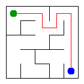

# Assignment 3. Maze Escape

- Student ID: 254319
- Name: Yerbol Aisyerik
- Group: SE-2536

Maze size (rows x columns): 8 x 9

This file is the report. How to start: `START_HERE.md`. The task: `docs/Assignment3.pdf`.

## Program output

The 13 lines my program prints on my data (`java -cp out Main`):

    Broken: 71
    Kept: 56
    Last broken wall: 112
    MST cost: 21802
    Heaviest broken wall: 712
    Path length: 19
    DFS visited: 51
    Dead ends: 23
    Zones: 72
    Largest zone: 1
    Is DAG: 1
    Flow stages: 17
    Fastest route cost: 17

My maze:

## Questions

Mission 0. What do find and union do, and what makes them fast in your code?

`find` follows the parent links from a cell until it reaches the root, and the root is the name of the group. `union` finds the two roots. If they are the same, it returns false. If not, it puts the smaller tree under the bigger tree and returns true. Two ideas make it fast. Union by size keeps the trees low. Path compression connects every cell on the way straight to the root, so the next `find` is very short. Together, one operation takes almost constant time.

Mission 1. Why is Broken always R*C - 1, and Kept always (R-1)*(C-1)?

At the start every cell is its own group, so there are R*C groups. Every broken wall joins two groups into one, so the number of groups goes down by one. At the end all cells are in one group, so exactly R*C - 1 walls are broken. For my 8 x 9 maze this is 72 - 1 = 71. The grid has R*(C-1) + (R-1)*C walls in total. If I take away the R*C - 1 broken walls, (R-1)*(C-1) walls are left. For me this is 127 - 71 = 56 = 7 * 8.

Mission 2. My MST cost from Kruskal and from Prim, and why they are equal:

Both Kruskal and Prim give 21802 on my maze. All wall costs are different, so there is only one cheapest maze (one minimum spanning tree). Kruskal always takes the cheapest wall that joins two different groups. Prim always takes the cheapest wall that goes out of the tree it is growing. Both rules are safe because of the cut property, so both algorithms build the same tree and get the same cost.

Mission 3. Why is there exactly one path between two cells? How did you avoid a stack overflow on a huge maze?

The broken walls make a tree. A tree is connected, so there is a path between any two cells. A tree has no cycles. If there were two different paths, together they would make a cycle, so there is only one path. To avoid a stack overflow, I did not use recursion. I wrote the DFS with my own `int[]` stack. For every cell I remember the next direction to try (up, right, down, left), so the program works like recursion but does not use the Java call stack.

Mission 4. Why does the second pass of Kosaraju go on the reversed graph? Why do the slides have no cycle exactly when Zones equals the number of cells?

The cell that finishes last in the first pass is in a "source" zone, which means no other zone has slides into it. If I start a DFS from it on the normal slides, it can go out into other zones. On the reversed slides, it can only reach cells that can come back to it, and these are exactly the cells of its own zone. Then I take the next cell and repeat, so I get the zones one by one. A cycle always puts two or more cells in the same zone. So if there is no cycle, every cell is a zone of its own and Zones equals the number of cells. In my data Zones = 72, which is the number of cells, so my slides have no cycle (Is DAG: 1).

Mission 5. Why is it enough to go through the zones in the order of their numbers? What does this pass cost?

The zone numbers from Kosaraju are a topological order. This means every slide between two zones goes from a smaller number to a bigger number. So when I come to a zone, all slides into it come from zones that I have already finished. Its best cost and its longest chain cannot change any more, so I need to look at each slide only once and I do not need a priority queue. The pass costs O(n + m).

## AI use

Claude: I used it to understand the requirements of the assignment and to help me understand the code of Missions 0-5 (DisjointSet, Maze, Escape, Zones and the extra DSU tests). I ran `tools/Check.java` and `Bench` myself, and I must be able to explain every line. I also read some websites and watched YouTube videos about these algorithms.

## Timing (Mission 7)

Milliseconds, 5 runs each, from `java -cp out Bench`.

| maze | Kruskal | Prim |
|---|---|---|
| 100 x 100 | 17 | 22 |
| 300 x 300 | 51 | 196 |
| 1000 x 1000 | 704 | 3167 |

What do the numbers say about how the time grows?

From 100 x 100 to 300 x 300 the maze has 9 times more cells, and from 300 x 300 to 1000 x 1000 it has about 11 times more. The time grows by about the same amount or a little more (Kruskal: 17, 51, 704 ms), which matches n log n. Prim is slower than Kruskal and grows faster, because its priority queue creates many small objects and jumps around in memory. Kruskal only sorts one simple array of numbers.

## Complexity

n is the number of cells, m is the number of walls (or slides).

| algorithm | time | space | assumptions |
|---|---|---|---|
| DSU find and union | O(alpha(n)) amortized | O(n) | union by size and path compression |
| Kruskal | O(m log m) | O(n + m) | sorting takes most of the time; m is about 2n |
| Prim | O(m log m) | O(n + m) | binary heap, old entries are skipped |
| DFS | O(n) | O(n) | the maze is a tree, so m = n - 1; own stack |
| Kosaraju | O(n + m) | O(n + m) | two DFS passes with own stacks |
| Route in the zone graph | O(n + m) | O(n + m) | zones in topological order, no heap |

## Before you submit

- data/walls.txt, data/slides.txt and output/maze.png are in the repository.
- `java tools/Check.java` shows all examples right.
- This README is filled in, the program output and the section AI use included.
- The work is pushed to main (at least one commit per mission) and the repository is public.
- The link is attached in Moodle.
